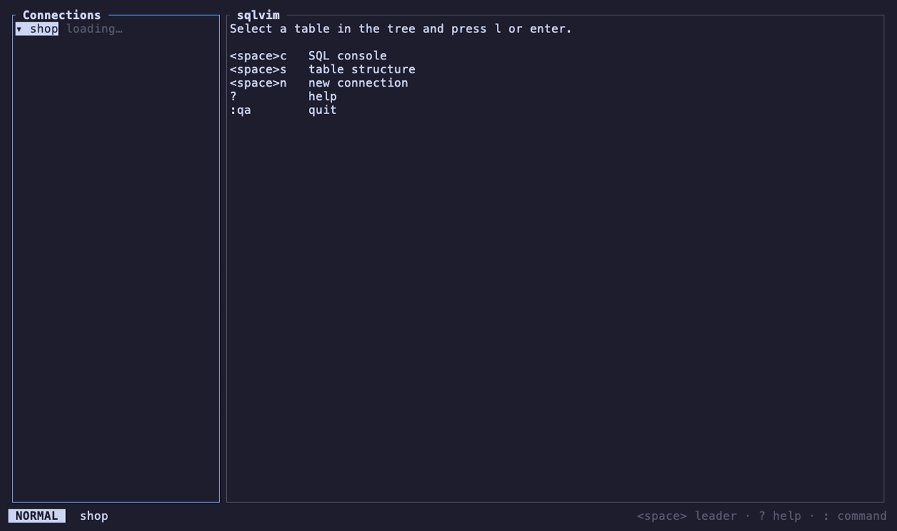

# sqlvim

一个带 vim 键位、DataGrip 式工作流的终端 SQL 客户端，支持 MySQL 和 PostgreSQL。

[English](README.md)



- 浏览数据库，过滤、排序表数据，并**直接编辑**：改动先暂存，以 SQL 预览后在一个事务里提交。
- 带语法高亮的 SQL 控制台，**内置 vim 编辑器**、自动补全，可交给 `$EDITOR` 编辑。
- `<Space><Space>` 搜索所有表、视图、列和函数；`<Space>e` 重新打开最近的 tab。
- 复制与导出结果（TSV、CSV、JSON、Markdown、INSERT、xlsx），SQL 历史。
- SSH 隧道（agent、密钥、ProxyJump），生产环境保护，手动事务。
- 自定义按键（`keymap.toml`）与颜色（`[theme]`）。

## 安装

```sh
brew install shepherd-yun/tap/sqlvim
```

或用 Go（版本见 `go.mod`）：

```sh
go install github.com/shepherd-yun/sqlvim/cmd/sqlvim@latest
```

macOS 与 Linux 的二进制包在 [Releases 页面](https://github.com/shepherd-yun/sqlvim/releases)。

## 配置

创建 `~/.config/sqlvim/connections.toml`，参见 [docs/examples/connections.toml](docs/examples/connections.toml)。
首次连接时 sqlvim 会询问密码，并可保存到 macOS 钥匙串。

可选的 `~/.config/sqlvim/config.toml`（参见 [docs/examples/config.toml](docs/examples/config.toml)）：

```toml
page_size        = 200
max_column_width = 40
max_rows         = 1000          # rows fetched per console query
editor           = "nvim"        # <space>v; default $VISUAL, $EDITOR, nvim
export_dir       = "~/Downloads"
```

还没有配置？启动 sqlvim 后按 `<space>n` 添加连接。

## 编辑表数据

改动会先暂存：改过的单元格变黄，新增行变绿，标记删除的行变红。
`<Space>w`（或 `:w`）显示将执行的语句；`y` 在一个事务里执行它们，任何一条失败或没有恰好改动一行都会整体回滚。
行按主键定位，没有主键时用全部列 NOT NULL 的唯一索引；两者都没有的表按所有列的值匹配
（MySQL 加 `LIMIT 1`）或按 `ctid`（PostgreSQL），预览里会注明。
只读连接拒绝改动，PROD 连接在预览中显示 `PROD ·`；有暂存改动时，翻页、刷新、过滤、排序、关闭 tab 或退出都会询问或拒绝。
控制台的结果保持只读。

## SSH 隧道

把 `ssh` 设为 `~/.ssh/config` 里的 `Host` 别名；此时 `host` 由 SSH 服务器解析：

```toml
[[connection]]
name     = "prod-pg"
driver   = "postgres"
host     = "10.0.1.5"   # as seen from the bastion
user     = "app"
database = "app"
env      = "prod"
ssh      = "bastion"
```

sqlvim 读取 `HostName`、`Port`、`User`、`IdentityFile`、`ProxyJump`（任意跳数）和 `UserKnownHostsFile`。
先尝试 ssh-agent，再尝试你的密钥文件，都不行时才询问密钥口令（口令只保存在内存里）。
未知主机会显示指纹，输入 `yes` 后加入 `known_hosts`；主机密钥变化视为错误。不支持 `ProxyCommand`。

## 按键

| 按键 | 动作 |
|---|---|
| `j` `k` `h` `l`, `gg` `G`, `Ctrl-d` `Ctrl-u` | 移动 |
| `l` / `Enter` | 展开节点 / 打开表（对断开的连接重试） |
| `h` | 折叠 / 回到父节点 |
| `Tab`, `Ctrl-h` `Ctrl-l` | 切换面板 |
| `1`–`9` | 跳到第 n 个 tab（控制台编辑器里数字是计数：用 `gt` / `gT` / `{n}gt`） |
| `H` `L`, `gT` `gt` | 上一个 / 下一个 tab，首尾循环（任何面板或 tab 中都可用） |
| `/` `n` `N` | 在树或结果表格中搜索 |
| `[` `]` | 上一页 / 下一页（数据）、上一节 / 下一节（结构）；`]` 在控制台加载更多行 |
| `0` / `$` | 表格：第一列 / 最后一列 |
| `zh` `zl` / `zH` `zL` | 表格横向滚动半屏 / 一列 |
| `K` | 显示单元格完整内容 |
| `ff` / `f!` | 过滤：该列等于 / 不等于单元格的值（NULL → `IS NULL` / `IS NOT NULL`） |
| `fs` 或 `f~` | 过滤：该列包含……（会询问，初始值为单元格；忽略大小写；`%` `_` 按字面匹配） |
| `fl` | 过滤：该列 LIKE 你输入的模式（`%` 任意文本，`_` 一个字符；初始为 `%cell%`；忽略大小写） |
| `f>` / `f<` | 过滤：该列大于 / 小于……（会询问，初始值为单元格） |
| `fn` / `fN` | 过滤：该列为 / 不为 NULL |
| `fx` | 清除过滤 |
| `F` | 以 SQL 编辑过滤条件（`WHERE …`）：从当前列开始，`Tab` 补全列名和关键字 |
| `s` | 表数据：按该列排序——升序、降序、取消 |
| `i` / `Enter` | 表数据：在 vim 编辑器中编辑单元格（`Enter` 保存，`Ctrl-n` 设为 NULL，`Esc` 回到 NORMAL / 取消） |
| `o` / `dd` | 表数据：在下方新增一行 / 标记该行删除 |
| `u` / `U` | 表数据：撤销上一处改动 / 放弃全部改动 |
| `<Space>w`, `:w` | 表数据：以 SQL 预览改动，`y` 在一个事务里提交 |
| `yl` / `yy` | 复制单元格 / 行 |
| `p` | 重新输入连接密码（树） |
| `<Space>c` | 为选中的连接 / 数据库打开 SQL 控制台 |
| `Enter` / `R` | 控制台：执行光标处语句或可视选区 / 执行全部（插入模式下 `Ctrl-Enter` 或 `Ctrl-j`） |
| `Ctrl-c` | 取消正在执行的查询（从不退出） |
| `Ctrl-j` / `Ctrl-k` | 控制台：切到结果 / 编辑器；`M` 切换消息日志 |
| `<Space>v` | 在 `$EDITOR` 中编辑控制台内容 |
| `<Space>h` | SQL 历史 |
| `<Space>y t/c/j/m/i` | 复制结果为 TSV / CSV / JSON / Markdown / INSERT |
| `<Space>yd` | 复制光标所在表的 DDL（树、数据 tab 或结构 tab）；在函数定义弹窗里按 `y` 复制其定义 |
| `<Space>x c/j/s/x` | 导出结果为 CSV / JSON / SQL / xlsx |
| `<Space>n` | 新建连接 |
| `e` | 树：编辑选中的连接（保存到 `connections.toml`） |
| `dd` | 树：删除选中的连接，或删除选中的表 / 视图（需输入名字确认） |
| `r` | 树：重命名选中的表或视图 |
| `a` | 树：当前节点的动作菜单，包括清空表 |
| `m` / `C` | 树：把表、MySQL 库或 PostgreSQL schema 标记为对比源 / 与当前节点对比（没有标记时从已加载的元数据里选源） |
| `x` / `]c` `[c` / `~` | Diff 标签页：变更纳入或不纳入脚本 / 下一处、上一处变更 / 交换源与目标 |
| `<Space>w` | Diff 标签页：把勾选的变更写成脚本，放进目标连接的新 console（在那里运行才会执行） |
| `<Space>s` | 列弹窗：输入即过滤，`Enter` 让数据 tab 的光标跳到该列（必要时先打开 tab），`Ctrl-o` 打开完整结构（索引、外键、DDL） |
| `<Space>S` | 直接打开光标所在表的完整结构，不经过列弹窗 |
| `<Space>b` | 显示 / 隐藏树 |
| `<Space>r` | 刷新树节点或 tab，并重新加载该连接的元数据 |
| `?` | 当前面板的帮助 |
| `:q` / `:qa` | 关闭 tab / 退出 |
| `<Space>t` | 控制台：切换手动提交（状态栏显示 `TX n`） |
| `:commit` / `:rollback` | 控制台：结束事务 |
| `:set noreadonly` / `:set readonly` | 本次会话解锁 / 锁定连接 |
| `:q!` / `:qa!` | 关闭 / 退出，不询问未结束的事务 |
| `<Space><Space>` | 搜索表、视图、列、函数、schema 和数据库（`@` 搜索所有连接，并加载尚未打开的连接的元数据；`Enter` 打开，`Ctrl-o` 打开结构） |
| `<Space>e` | 最近打开的表、结构和控制台 |
| `↓` / `↑`, `Ctrl-n` / `Ctrl-p`, `Ctrl-j` / `Ctrl-k`, `Tab` / `Shift-Tab` | 控制台插入模式：下一个 / 上一个补全（弹窗关闭时 `Ctrl-n` / `Ctrl-p` 打开它） |
| `Enter` / `Ctrl-y` | 控制台插入模式：接受补全（`Esc` 关闭弹窗，再按一次 `Esc` 离开插入模式） |

`f…` 生成的过滤条件以 `AND` 叠加；`F` 显示并编辑完整条件。文本输入框支持 readline 键：
`←` `→`、`Home` `End` / `Ctrl-a` `Ctrl-e`、`Alt-b` `Alt-f`、`Ctrl-w`、`Ctrl-u`、`Ctrl-k`。

按下 `<Space>` 稍等即可看到所有 leader 键。以上是默认按键，见「自定义」。

## 自定义

**按键** —— `~/.config/sqlvim/keymap.toml` 可以更换 leader，并按上下文绑定、改绑或解绑按键
（[包含全部动作的示例](docs/examples/keymap.toml)）：

```toml
leader = ","

[grid]
"S" = "sort.column"
"s" = ""
```

sqlvim 启动时检查该文件，指出未知或冲突的绑定。帮助（`?`）、which-key 和各处提示都会跟随你的按键。
控制台编辑器的 vim 键、文本输入框和弹窗列表的按键保持不变。

**颜色** —— `config.toml` 中的 `[theme]` 表；值为 ANSI 色号 `"0"`–`"255"` 或 `"#rrggbb"`。
槽位：`border` `focus` `error` `accent` `on_error` `visual_bg` `visual_fg`
`changed` `inserted` `view` `builtin` `string` `number` `operator`。

```toml
[theme]
focus  = "#7aa2f7"
accent = "14"
```

**Ghostty** —— 用 [docs/examples/ghostty.conf](docs/examples/ghostty.conf) 把 Cmd 快捷键映射到 leader 键，
例如 `keybind = cmd+e=text:\x20e`。

## 控制台编辑器

控制台是一个 vim 编辑器：NORMAL、INSERT、VISUAL（`v`）和 V-LINE（`V`）模式；
移动 `h j k l w b e W B E 0 ^ $ gg G f F t T % { }` 与 `Ctrl-d` `Ctrl-u`；操作符
`d c y > <` 搭配移动、文本对象（`iw aw i" a" i' a' i( a( i[ a[ i{ a{`）或重复一次
（`dd` `cc` `yy` `>>` `<<`）；`x D C p P o O i a I A`；`u` / `Ctrl-r` 撤销与重做；`.`
重复上一次修改；计数（`3dd`、`2dw`）；寄存器 `"a`–`"z`，`"+` 为系统剪贴板。编辑器里数字是计数，
所以用 `gt` / `gT` / `{n}gt` 或 `H` / `L` 切换 tab。VISUAL 模式下 `Enter` 执行选中的语句。
`>` 和 `<` 缩进四个空格；INSERT 模式下 `Tab` 输入四个空格。

不支持：宏、ex 范围、窗口、`/` 搜索——需要时用 `<Space>v` 在 `$EDITOR` 中打开控制台。

## 搜索与补全

sqlvim 在你第一次使用某个连接时于后台读取其目录（表、视图、列、函数）——MySQL 读整个服务器，
PostgreSQL 每次一个数据库——并保存在内存中。`<Space>r` 重新加载；在控制台执行 DDL 会自动重新加载。

在控制台中，补全随输入弹出：`FROM`/`JOIN`/`UPDATE`/`INTO` 之后是表，语句中各表（及 `alias.`）的列，
其他位置是关键字。需要引号的名字（`order`，PostgreSQL 上的 `MixedCase`）会带引号插入。
语句因语法错误失败时，光标会跳到服务器报告的出错位置。

## 安全

- `readonly = true`（`env = "prod"` 时默认开启）在控制台中阻止 INSERT/UPDATE/DELETE 和 DDL，
  数据库会话本身也设为只读，作为第二道防线。`:set noreadonly` 在 sqlvim 退出前解锁该连接；
  不会修改 `connections.toml`。
- `env = "prod"` 用红色框住 tab 区域，并在状态栏显示 `[PROD]`；prod 连接上的每条写入或 DDL 语句都会先要求按 `y` 确认。
- 不带 `WHERE` 的 `UPDATE` / `DELETE` 需要先输入表名才会执行。
- 手动提交模式（`<Space>t`）下，退出或关闭有未结束事务的控制台会先询问。若事务期间连接断开，
  sqlvim 会提示事务已丢失，而不是悄悄重连。请用 `<Space>t` 而不是 `SET autocommit = 0`。

## 开发

```sh
make test               # unit tests
make test-integration   # needs Docker (OrbStack: `orb start`)
make lint
make snapshot           # build release archives locally with GoReleaser
make demo               # re-record docs/demo.gif (needs vhs and Docker)
```

日志：`~/.local/state/sqlvim/sqlvim.log`（`--debug` 输出更多细节）。
提交 pull request 前请阅读 [CONTRIBUTING.md](CONTRIBUTING.md)。

## 许可证

MIT —— 见 [LICENSE](LICENSE)。
